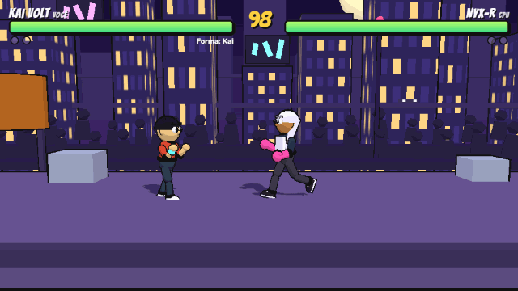
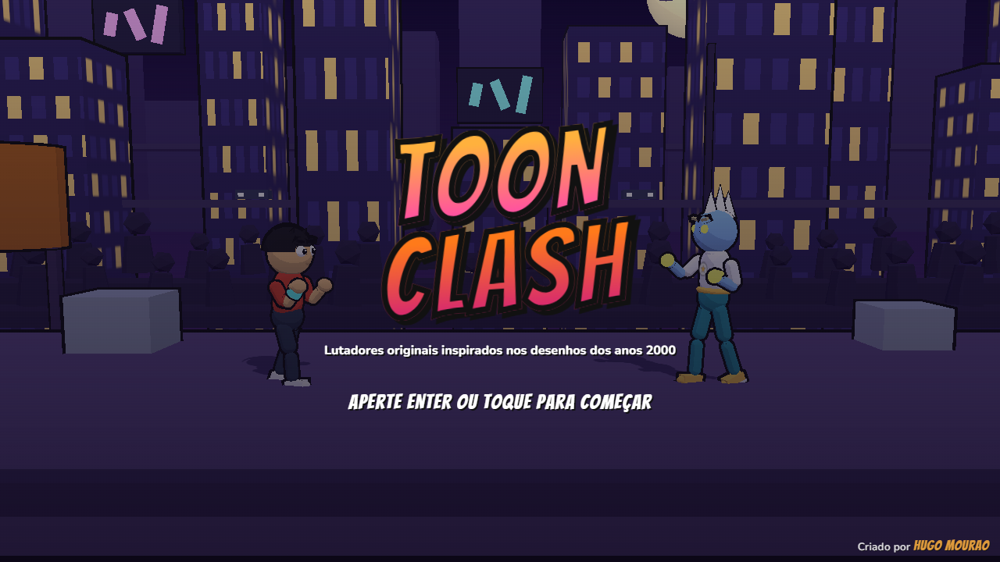
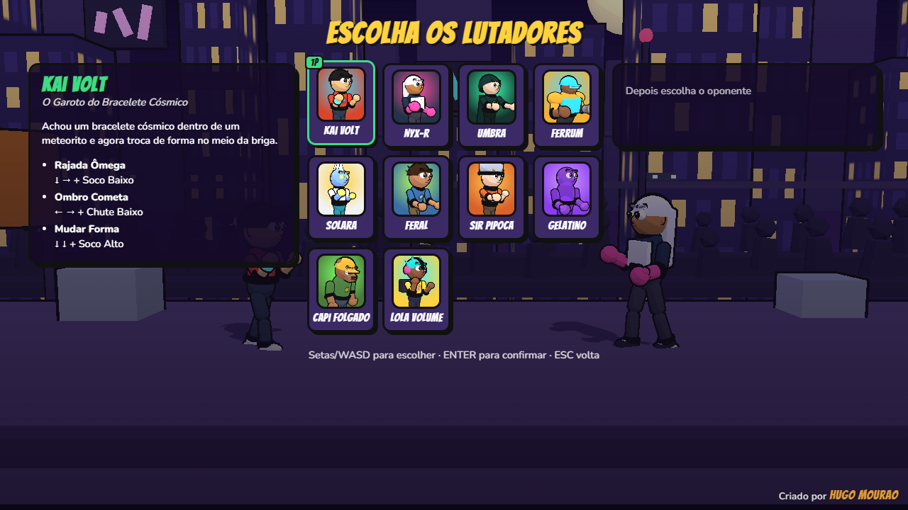
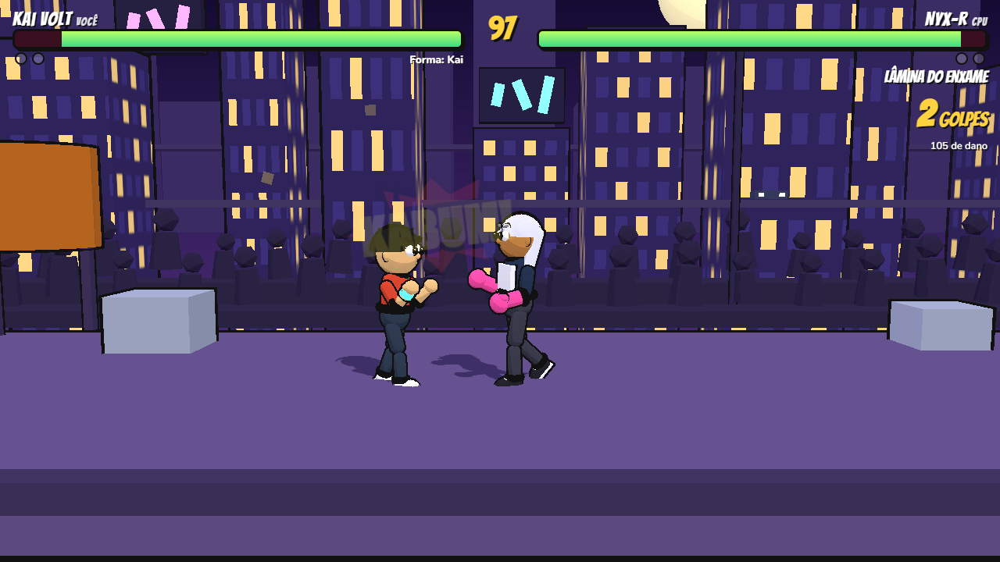

# Toon Clash

[](https://github.com/huguerra1/toon-clash/actions/workflows/ci.yml)
[](LICENSE)

Jogo de luta 1x1 estilo Mortal Kombat, em 2.5D, rodando direto no navegador com
[Three.js](https://threejs.org/). Personagens originais inspirados nos desenhos animados dos anos 2000.

**Jogue:** https://huguerra1.github.io/toon-clash/



| Tela inicial                                       | Escolha de lutadores                                      | Luta contra a CPU                                |
| -------------------------------------------------- | --------------------------------------------------------- | ------------------------------------------------ |
|  |  |  |

## O que tem

- **11 lutadores** com golpes especiais próprios: Kai Volt (troca de forma), Nyx-R (armas de
  microrrobôs), Umbra (sombras e teleporte), Ferrum (canhão e armadura), Solara (estrelas e voo),
  Feral (vira animais), Sir Pipoca (baguete encantada), Gelatino (braços elásticos), Capi
  Folgado (ancinho e fitas), Lola Volume (ondas sonoras) e o chefe Warlord Zhaar (liberado ao
  zerar o Arcade).
- **Combate**: combos encadeados, cancelamento em especiais, agarrões, golpes baixos/altos,
  lançamentos e juggle, hitstop, dano na defesa e **Toonalities** — finalizações cômicas no
  lugar de fatalities.
- **Modos**: Tutorial, Arcade (6 lutas + chefe), Versus local, Contra a CPU, Treino e Online.
- **CPU** com 4 níveis: Fácil, Médio, Difícil e Pesadelo.
- **Treino** com boneco configurável (parado, defende, agachado, pulando ou CPU).
- **Online** com salas por código e netcode com rollback — veja [docs/ONLINE.md](docs/ONLINE.md).
- **Controles**: teclado (2 jogadores, teclas de luta remapeáveis), controle (Gamepad API) e toque
  no celular.
- **Acessibilidade**: opções para reduzir ou desligar o tremor de tela e reduzir os flashes (respeita
  o "reduzir movimento" do sistema).
- **Áudio** 100% sintetizado (efeitos, músicas e locutor em português).
- **VR**: modo espectador em óculos com WebXR.
- **Visual**: rosto expressivo, squash & stretch, partes que balançam, brilho (bloom) e 6 cenários
  animados com plateia. Modelos feitos no Blender podem substituir os de primitivas —
  veja [docs/MODELOS-3D.md](docs/MODELOS-3D.md).

## Como rodar

Precisa do [Node.js](https://nodejs.org/) 22 ou mais novo.

```bash
npm install
npm run dev
```

Abra http://localhost:5173. Para o online local, rode também `npm run server`.

| Ação                    | Jogador 1 | Jogador 2  | Controle           |
| ----------------------- | --------- | ---------- | ------------------ |
| Mover / pular / agachar | W A S D   | Setas      | Direcional         |
| Soco Baixo              | F         | K ou Num 4 | X / □              |
| Soco Alto               | G         | L ou Num 5 | Y / △              |
| Chute Baixo             | V         | , ou Num 1 | A / ✕              |
| Chute Alto              | B         | . ou Num 2 | B / ○              |
| Defender                | Espaço    | J ou Num 0 | LB / RB / gatilhos |
| Pausa                   | ESC       | ESC        | Start              |

A lista de golpes de cada lutador fica no menu de pausa. As teclas de luta podem ser trocadas em
**Controles → Remapear teclas**. A tabela completa de frame data (startup, ativos, recuperação e
vantagens) está em [docs/FRAME-DATA.md](docs/FRAME-DATA.md).

## Scripts

| Comando                | O que faz                                                  |
| ---------------------- | ---------------------------------------------------------- |
| `npm run dev`          | Servidor de desenvolvimento com recarga automática         |
| `npm run server`       | Servidor de salas do modo online (porta 8787)              |
| `npm test`             | Testes (Vitest)                                            |
| `npm run lint`         | Verifica o código com ESLint                               |
| `npm run format`       | Formata o código com Prettier                              |
| `npm run build`        | Gera a versão de produção em `dist/`                       |
| `npm run frame-data`   | Gera `docs/FRAME-DATA.md` a partir dos dados dos lutadores |
| `npm run package:itch` | Gera o build e o `.zip` para o Itch.io em `release/`       |

## Estrutura

```
src/
  core/        game loop (60 Hz fixo), input, teclado/controle
  combat/      tipos, frame data, hitbox, comandos especiais
  game/        a partida: rounds, golpes, física (sem Three.js, determinístico)
  characters/  dados de golpes e visual de cada lutador
  ai/          CPU e boneco de treino
  render/      Three.js: modelos, poses, efeitos, cenários, Toonalities, VR
  audio/       efeitos, músicas e locutor sintetizados (Web Audio)
  ui/          menus, HUD, controles de toque
  net/         online: cliente WebSocket e rollback
server/        servidor de salas (Node + ws)
```

Regras de código para humanos e agentes de IA: [AGENTS.md](AGENTS.md). Plano: [PLANO.md](PLANO.md).

## Aviso

Projeto de fã, sem fins comerciais e sem ligação com a Cartoon Network ou a Warner Bros. Discovery.
Todos os personagens são criações originais.
