# Estilo visual: de "3D genérico" para desenho de TV

Os lutadores tinham cara de vídeo feito por IA: olhos de vidro com brilho, nariz de bolinha,
sombra em degradê de 3 tons, luz de contorno roxa e o mesmo corpo de cápsulas para todo mundo.
Esta refatoração aproxima o jogo do visual de desenho animado de TV dos anos 2000 **sem copiar
personagem nenhum**: só técnicas de estilo (traço, cor chapada, formas simples, poses legíveis).

## Antes e depois

| Antes                                        | Depois                                         |
| -------------------------------------------- | ---------------------------------------------- |
| 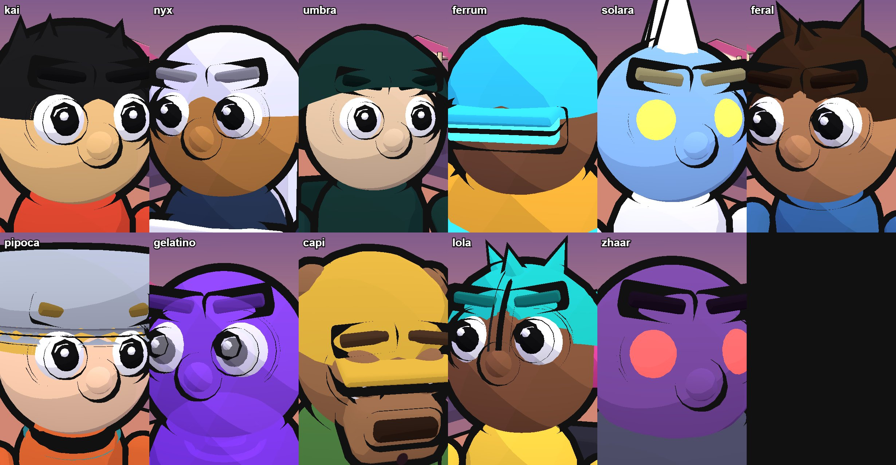 | 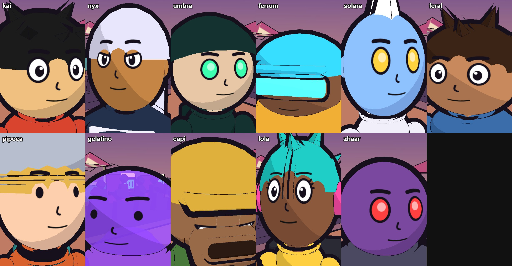 |
| 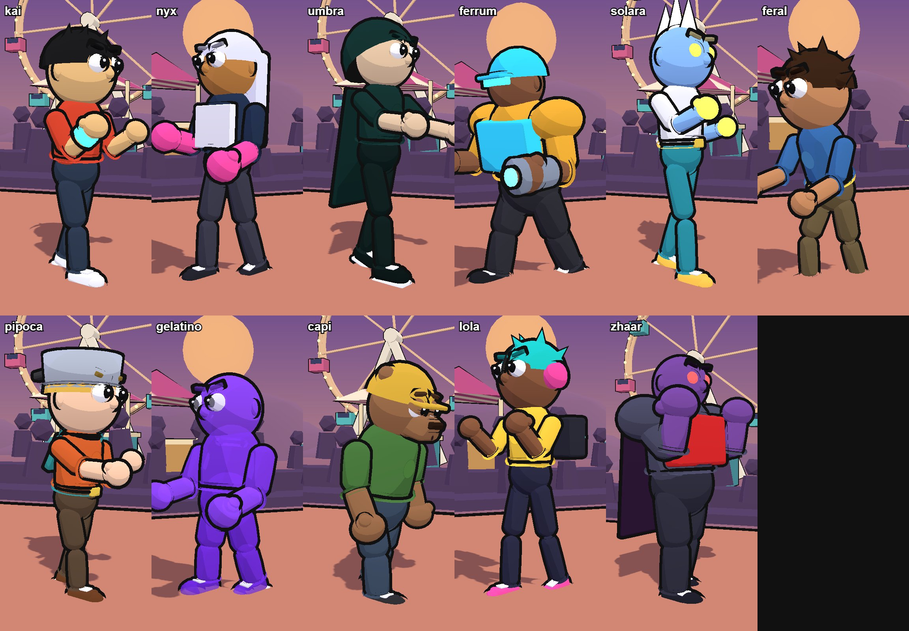 | 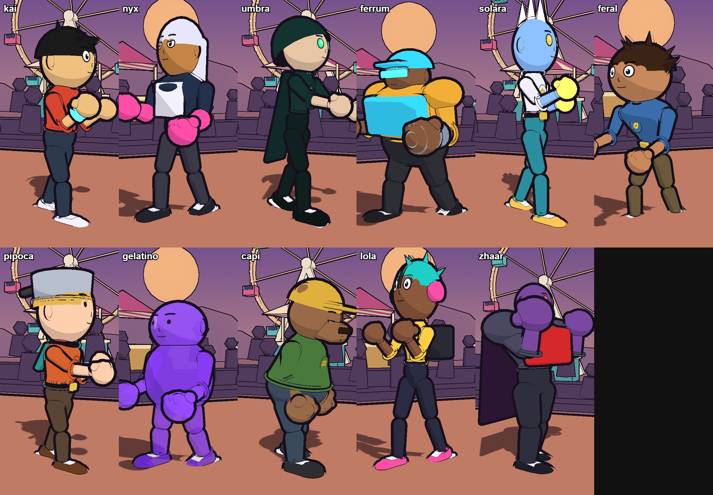 |
| 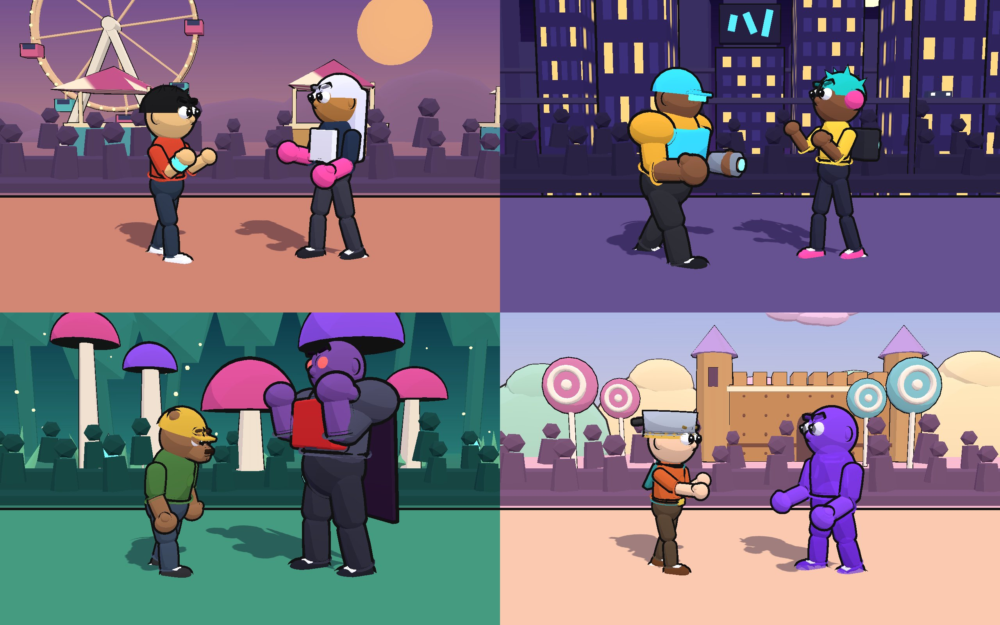     | 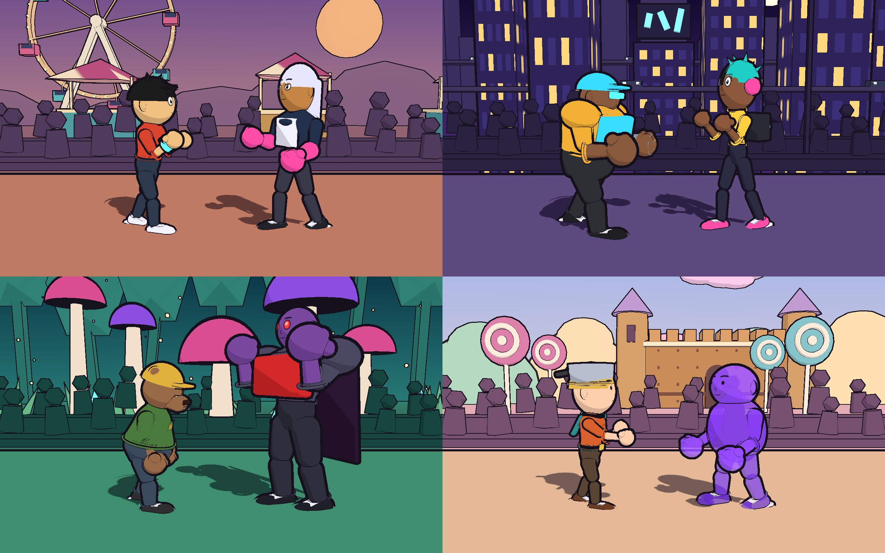     |

Silhuetas (cada um precisa ser reconhecível só pela sombra):

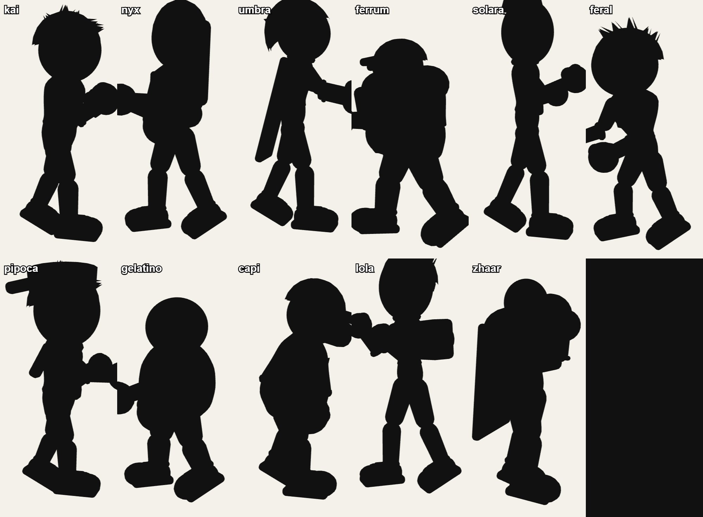

Expressões do rosto desenhado:

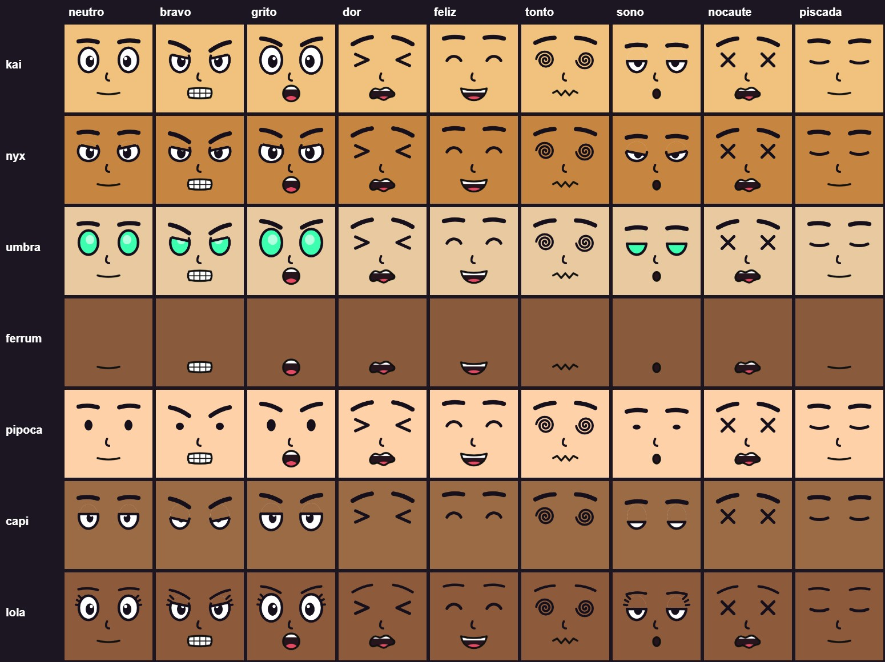

## O que mudou

### 1. Luz e traço

- Sombra toon de **2 tons** (luz e sombra chapadas), luz ambiente sem degradê e sem a luz de
  contorno roxa (`src/render/toon-material.ts`, `src/render/scene.ts`).
- Na qualidade alta, um passe de **nanquim** (`src/render/ink-outline.ts`) desenha silhuetas e
  cantos vivos do cenário e da plateia. Os lutadores mantêm o contorno grosso de casca, que lê
  melhor de longe. Efeitos ficam de fora (`userData.noInk`).

### 2. Rosto desenhado

`src/render/face-sheet.ts` desenha olhos, sobrancelhas, nariz e boca num canvas e cola num
pedaço de esfera na frente da cabeça. Cada lutador tem um estilo (`face` no `look.ts`):

| Estilo   | Quem                         | Ideia                                     |
| -------- | ---------------------------- | ----------------------------------------- |
| `round`  | Kai, Feral                   | olhão redondo, herói                      |
| `sharp`  | Nyx                          | olho amendoado, meio fechado, "descolada" |
| `glow`   | Umbra, Solara, Zhaar, Faísca | olho de energia, sem pupila               |
| `visor`  | Ferrum                       | só a boca; o visor brilha por cima        |
| `dot`    | Pipoca, Gelatino             | olhinho de ponto, bobo                    |
| `sleepy` | Capi                         | pálpebra sempre caída                     |
| `lashes` | Lola                         | cílios em gancho                          |

Piscar e mudar de expressão é só trocar a textura (cache por chave, sem custo por quadro).

### 3. Formas (Blender)

`tools/blender/build_fighters.py` monta os troncos por **perfil** (`body` no `look.ts`):
`wedge` (ombro largo: Nyx, Feral, Zhaar), `block` (Ferrum, Rochedo), `pear` (Capi), `slim`
(Umbra, Solara, Lola, Faísca), `blob` (Gelatino) e `standard`. Cabeças são elipsoides
(`headShape`), braços afinam no punho, mãos são luvas grandes com dedos e os tênis são grandes.
O `.glb` marca o centro do rosto (`face`) e o ponto do emblema (`emblem`).

Para regenerar:

```bash
node tools/blender/looks-json.mjs
"C:\Program Files\Blender Foundation\Blender 5.2\blender.exe" --background --factory-startup --python tools/blender/build_fighters.py -- tools/blender/looks.json public/assets/fighters
```

### 4. Poses e animação

- Guarda com linha de ação em "C": tronco para o oponente, cabeça erguida, base aberta.
- Opções → **Animação: desenho** segura cada pose por 1/15 s, como animação feita à mão ("em
  dois"). A troca para golpe ativo, recuperação ou outro estado aparece na hora, para nenhum
  golpe ficar escondido.

### 5. Roupas com detalhe

Cada lutador tem uma roupa descrita em `outfit` no `look.ts` (mangas, cor de acabamento, jaqueta
aberta, zíper, botões, bolsos, barra dobrada, remendo no joelho, listras, barra rasgada, bico do
tênis). O Blender monta os detalhes como **preenchimento chapado + traço de nanquim** colados na
superfície (peças `flat:`, sem contorno de casca). Gola, barra, punhos, cinto e cachecol eram
anéis (toros) que flutuavam em volta do braço e, com o contorno, viravam riscos pretos tortos.
A orelha sem contorno deixou de parecer um segundo olho, e a armadura virou um peitoral curvo.

| Antes                                            | Depois                                             |
| ------------------------------------------------ | -------------------------------------------------- |
| 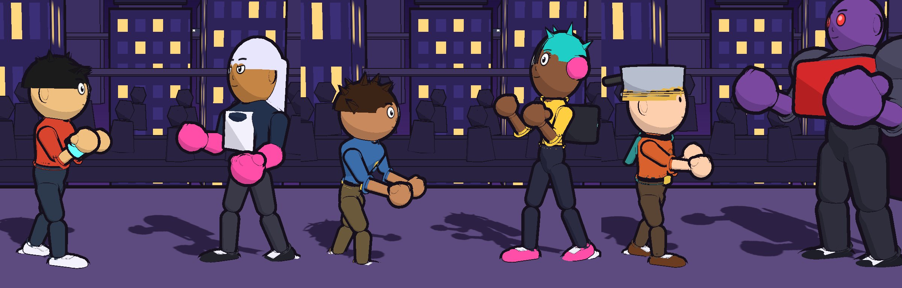     | 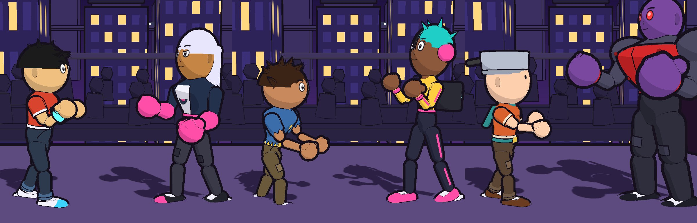     |
| 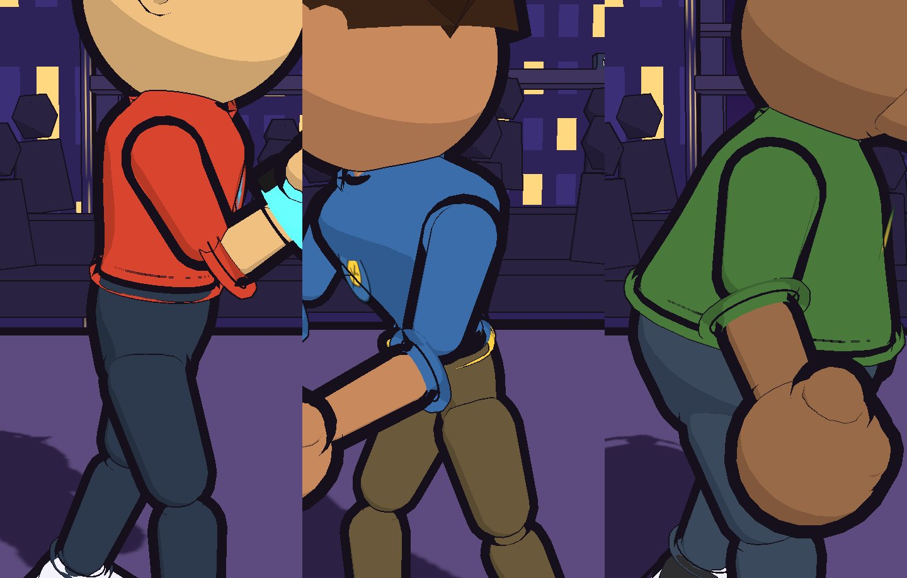 | 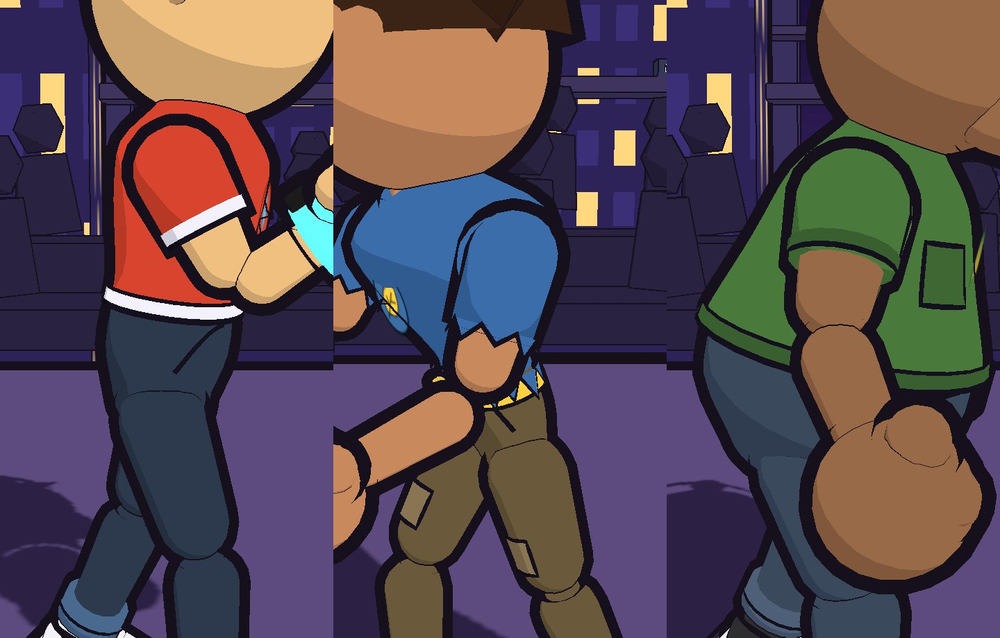 |

## Correções encontradas no caminho

- Canvas de textura agora são desenhados pela CPU (`src/render/canvas.ts`): no canvas acelerado
  de alguns navegadores, traços com vários segmentos sumiam (sobrancelhas, bocas, detalhes).
- O contorno por normal copiava a geometria sem o índice e embaralhava os triângulos em malhas
  do `.glb`.
- Corpo translúcido (Gelatino) desenha o contorno depois do corpo, para não aparecer por dentro.
